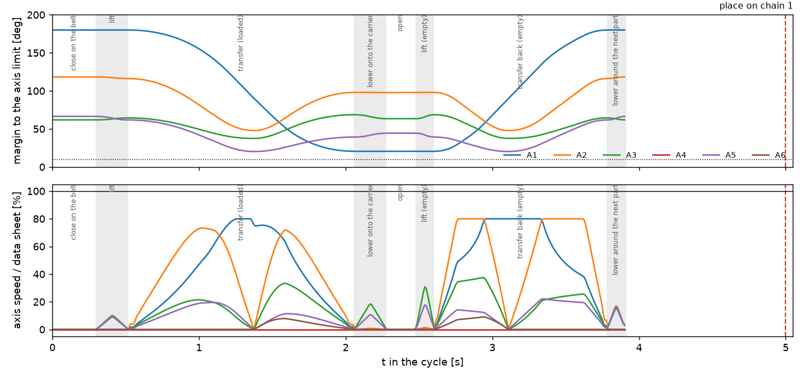
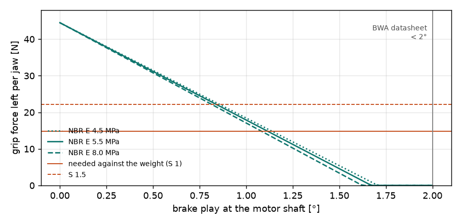
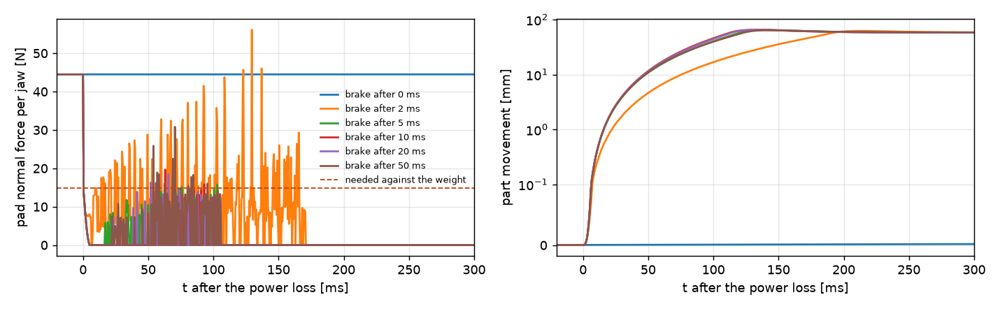

# E4 - MuJoCo cell and grip validation

ABB IRB 1300-7/1.4 on its pedestal, the gripper on the ISO 9409 flange, part B on the buffer belt and the
workpiece carrier. The model is generated from the sources, nothing is drawn by hand.

| File | Purpose |
|---|---|
| `export_meshes.py` | robot links (ABB STEP) and part B (FH STEP) as STL, `fc.sh export_meshes.py`; third-party, so `meshes/` is gitignored |
| `build_model.py` | MJCF from `06_Cell/cell_params.py` (layout, kinematics), the gripper build (`02_CAD_Body/out`) and the meshes |
| `sim.py` | poses from the closed-form IK, part placement in the jaws, rendering; `python sim.py` renders pick and place |
| `validate_grip.py` | grip validation over the real path, `python validate_grip.py` |
| `drive.py` | motor curve (ST4118S at 24 V from R, L, holding torque), reflected drive inertia, fastest move |
| `closing_time.py` | closing time and impact on the part, `python closing_time.py` |
| `power_fail.py` | power loss with the part in the jaws: detent only until the brake engages |
| `brake_play.py` | grip force left after the brake's rotational play (chain stiffness from FEM, pad, shaft); time until the preload is gone |
| `viz.py` | slow-motion video with four cameras, contact points and forces, clearance check (convex hulls) |
| `cell_video.py` | running cell at the 5 s takt: parts queue on the buffer line, the robot loads chain 2 and chain 1 in turn (chain 1 = mirrored E4 path), the carriers index into the machine; kinematic replay, [`figures/cell_takt.mp4`](figures/cell_takt.mp4) |
| `validation_notebook.py` | everything live: `marimo edit validation_notebook.py` |

**Model.** Robot joints follow the path through stiff position control with gravity compensation (the robot's own
dynamics are not the question here). The two jaws are slide joints driven together through a tendon (pinion and two
racks) by one position actuator whose force limit is 2 × the force per jaw: the current-limited motor. Rotor,
gearbox, brake and bevel pair sit on the slides as armature (3.2 kg reflected on the jaw coordinate, `drive.py`). NBR pad on
PA 6 with μ = 0.2 (oily part), elliptic friction cone, noslip solver. Part B as a free body, 0.602 kg, contact shape
from two boxes (body with the flat grip faces, lug) because its convex hull would touch the left pad.

**Path.** Pick on the belt, lift 60 mm (0.22 s on the loaded time law, see below), transfer to the carrier on the ABB MoveJ path through the via
(see "Enclosure and transfer path"), lower 60 mm. Axis 1 turns about 160°, so the TCP sees up to 5 m/s², not the 2.05 m/s²
of a straight 1.8 m line that the hand calculation assumes. E-stop (category 0) at the worst instant found by
`e_stop.py`: each axis brakes on its own with its deceleration from the ABB product specification (3HAC070393
rev. M, p. 91) and the robot leaves the path; 14.2 m/s² at the TCP. Assumption: the brake locks the drive with the
preload kept (full grip force at brake engagement).

**Results, 22 Nov 2026** (`out/grip_results.json`, `figures/grip_slip.png`), wide T-jaw pad, part B with the mass
properties of its CAD mesh. Timing as the robot runs it (`e4_cycle.py`): the built two-stage close from fully open
(0.40 s), then the lift (0.22 s), the transfer through the via (1.86 s) and the lowering, all on the time law with
TCP acceleration <= 4.96 m/s² (WorldAccLim). The simulated robot following it overshoots to 5.9 m/s² for a moment
(servo response); the friction use includes it. Friction use = |vector sum of the pad friction forces| / (μ ΣF_n),
median over the moving phases and 50 ms peak. "Held" = both pads in contact and each below its friction limit at
every physics step, part not dropped, movement beyond the creep base < 0.5 mm. This is retention during the
unsupported motion; the per-pad check uses each pad's resultant, so local sliding inside one pad is not resolved, and
the placing accuracy on the carrier is not evaluated (the run ends with the jaws closed).

| Case | Force per jaw | friction use median / peak (where) | worst pad, every step | part movement (raw / beyond creep base) | |
|---|---|---|---|---|---|
| required (hand calc., 2.05 m/s²) | 35.7 N | 0.42 / 0.64 (lift) | 0.91 | 2.25 / +0.00 mm | held |
| no safety (F / S) | 17.9 N | - / 1.00 | 1.00 | dropped | expected: sized for 2.05 m/s², the path needs 4.96 |
| **setpoint** (path 4.96 m/s², WorldAccLim) | 44.5 N | 0.34 / 0.52 (lift), S_eff 1.93 | 0.74 | 2.25 / -0.00 mm | held |
| e-stop at required, category 0, axes brake on their own | 35.7 N | 0.41 / 0.70 (transfer) | 1.00 | 0.33 / +0.00 mm | held, at the limit |
| e-stop at setpoint | 44.5 N | 0.33 / 0.56 (transfer), S_eff 1.79 | 0.85 | 0.33 / -0.00 mm | held |

The governing instant is the lift: straight up at the loaded acceleration, so m (g + a) acts on the pads in full,
which is exactly the design case of V2 (S = 2 at the commanded 4.96 m/s²; the simulation's 1.93 comes from the
servo overshoot). The e-stop runs on chain 1, whose worst stop needs the most force (e_stop.py). Its margin (1.79) is the reciprocal of the filtered net friction use in the dynamic
replay; the separate shear-and-twist check below gives 1.30 for the same stop (worst pad, twist included).

Until 21 Nov the jaws started 0.3 mm before the part, snapped shut at full force and the lift came 0.4 s later at a
gentle 1.7 m/s². That run showed its peak (0.74 at the setpoint) right at the start of the lift, whether the lift
started at 0.50 or 0.70 s; it was read as a via-corner peak, and the gentle lift hid the real governing case.
`run(offset=None)` still reproduces the old start.

**Why S = 2 is enough here.** No higher factor is prescribed by the task. μ = 0.2 is the worst-case literature value
for NBR on oily PA 6, not a measured one (the grooved pad's expected 0.3 is the reserve). Normal operation has no
shocks; the category 0 e-stop is checked as its own load case and held. A dropped part stays inside the fenced cell
and endangers nobody. The grip force is calibrated at commissioning; pad wear and a drifting current limit are a
maintenance item (re-check the grip force at the service interval).

## Emergency stop anywhere in the cycle (`e_stop.py`, `out/e_stop.json`, `figures/e_stop.png`)

**Which e-stop deceleration where (review section 2):**

| Value | What it is | Used in |
|---|---|---|
| 17 m/s² | ABB stop data axis 1 (p. 91) times the full reach 1.4 m: conservative lever | V2 § 2, hand calculation |
| 12.1 m/s² | the same axis 1 rate at our largest TCP radius (1.0 m) | `05_FEM/load_cases.A_STOP` (reported) |
| 22.3 m/s² | \|a_CoM - g\| of the part with every axis braking at its ABB rate, worst instant of the cycle | `e_stop.py`, governing for the grip |
| 82 m/s² | ABB design value for tool strength (p. 54, nominal load) | FEM LC4 (strength) |
| 7.0 m/s² | braking along the path, superseded | - |

Review 21 Nov: the e-stop above used to brake along the path (7.0 m/s²), which is milder than a real category 0
stop, and the ABB stop data (p. 91) hold for max speed, arm stretched and max load, i.e. the *weakest*
deceleration; with our half-nominal load and the arm pulled in the robot brakes harder. `e_stop.py` starts a
category 0 stop every 10 ms of the loaded cycle on both chains: each axis decelerates at a constant rate until it
stands, the robot leaves the path; part B's acceleration (gravity included) and the gripper's angular acceleration
go through the pad's friction limit surface (shear + twist, `02_CAD_Body/grip_check.py`, shift of normal force
between the jaws included). Normal force per jaw needed at S = 1:

| Deceleration of the axes | worst instant | part acceleration incl. g | needed per jaw | setpoint 44.5 N |
|---|---|---|---|---|
| ABB stop data (p. 91) | loaded transfer, t = 0.95 s | 22.3 m/s² | 34.3 N | held, S 1.30 |
| twice the ABB rates (sensitivity) | start of the transfer, t = 0.58 s | 42.7 m/s² | 57.5 N | slips |
| ABB design value 82 m/s² (p. 54, nominal load) | - | 82 m/s² | ~110 N | slips |
| ABB stop data, grooved pad µ 0.3 (expected, V5) | t = 0.55 s | 23.7 m/s² | 24.2 N | held, S 1.8 |
| twice the ABB rates, grooved pad µ 0.3 | t = 0.58 s | 42.7 m/s² | 41.5 N | held, S 1.07 |

Decision 21 Nov: more friction, not more force. More force would mean a bigger motor (60.5 N per jaw at full current); a higher friction coefficient costs nothing in loads and weight. The pads get vertical oil-drain grooves;
the design proof keeps µ = 0.2, the grooved pad's expected µ ≥ 0.3 (oil-resistant NBR gripper pads 0.3 ... 0.4,
HKI) is the reserve for hard stops and is measured in V5 (`Viktoriia/05_Print_Check/friction_test.md`). The 82 m/s²
case is not held by any reasonable friction grip (it would need 123 N at µ 0.2); there the closed enclosure keeps a
slipping part inside the cell, and the brake keeps the jaws closed.

The grip force does not rise in an e-stop (the brake holds the preload; the part's inertia goes into the pad
friction), so the drive sees no extra load. Bevel pair, key and overloads: `02_CAD_Body/drive_margin.py`
(review 1.7: m 1.5 pair since 21 Nov). The 82 m/s² are ABB's value for tool strength: FEM load case LC4 uses them (S ≥ 12.5).

**Creep base.** On the via path the part creeps 2.3-2.4 mm along the pads whatever the grip force: 25, 35.7, 44.5,
48.5 and 100 N per jaw all give the same movement, a finer time step gives more (1 ms 1.72, 0.5 ms 2.38, 0.25 ms
2.70 mm), a 100 x stiffer contact impedance only 1.72 mm, the friction cone (elliptic / pyramidal, condim 3/4/6)
and noslip iterations change nothing essential. Real slip would shrink with the grip force, so this is the soft
contact model, not the grip. Slip is therefore measured beyond a reference run at 100 N per jaw on the same path
(`creep_base`), limit 0.5 mm. Two pad springs (NBR shear, `build_model.py`) now share the tangential load between
the pads as the rubber does: before, one pad sat at its friction limit while the other pulled the other way.

**What the simulation does and does not validate (review 1.14).** `friction_check` compares the simulated friction
use with m (a - g) / (mu N) evaluated on the *simulated* part acceleration and normal force; the medians agree within
0.1 %, but that only checks the friction bookkeeping, it is no validation of V2 (circular). The independent
comparison is against the design inputs:

| at the setpoint 44.5 N, mu 0.2 | V2 (translation only, a 4.96 m/s²) | grip_check (horizontal path case with twist, uniform / tilted pad) | MuJoCo |
|---|---|---|---|
| friction use, median over the moving phases | 0.50 | - | 0.33 |
| friction use, peak | 0.50 | 0.40 / 0.43 | **0.52** (lift) |
| safety against slip at the peak | 2.0 | 2.48 / 2.30 | **1.93** (mu 0.3: 2.90) |

The grip_check column is the horizontal path case (4.96 m/s² along the pad, gravity added), not the vertical lift, so
it is no prediction for the MuJoCo peak. The simulated peak sits at the lift and equals the quasi-static value at that
instant (0.517); it is 3 % above V2's 0.50, consistent with the simulated robot exceeding the commanded acceleration
(TCP up to 5.9 m/s²). The quasi-static value is a balance check
on the simulated acceleration and normal force, not an independent prediction. The part does not slip anywhere.

**Monte Carlo study** (`robustness.py`, `out/robustness.json`, `figures/robustness.png`): 10 000 full cycles,
Latin hypercube over the part position (+-5 mm, CAD_PLAN point 0, assumed), pad friction (0.2 ... 0.3), grip force
(44.5 N +-5 %, calibration at commissioning) and part mass (+0 ... +3 %, PA 6 moisture in standard climate 23 °C /
50 % RH, data sheet 2.5 ... 3 %; a lighter part is easier). All 10 000 held, no pad lost contact, worst pad per
step 0.84; the highest sampled 50 ms friction use is 0.557 (S 1.80), always at the lift. The Latin hypercube does not
hit the joint extremes, so the 16 corners are run as well (`--corners`): all held, the worst (μ 0.2, F -5 %, mass
+3 %) at 0.561, S 1.78 (hand calculation 1.85). Stress set (2 000 cycles, μ down to 0.08, F down to 50 %): the
lowest sampled μF that held is 4.38 N per jaw, the highest that failed 4.56 N (different mass and offset, so the two
overlap; the hand calculation without safety gives 4.45 N); the weakest sampled grip in spec has μF = 8.47 N. These ranges are a sensitivity study, not a
measured production distribution. A heavier part as if water-saturated (+9 ... +10 % mass and inertia, `--saturated`, 200 cycles, μ 0.2 ... 0.3,
seating free as in spec) still holds: peak 0.571, S 1.75.

**Part width** (`--width`, `out/width_tolerance.json`), assumed within ISO 2768-m (+-0.3 mm): both jaws are within
5 % of the setpoint at 370 ... 385 ms (5 ms log samples), before the lift at 400 ms. The cycle lifts at a fixed
time, so a part more than about 0.75 mm too thin is lifted before the grip force is complete; the drive keeps closing
during the lift (1 mm: 37 N at the last sample before the lift, 1.5 mm: 14 N, both held); a part 2 mm thinner slips
in the jaws. The width is modelled by widening the contact box (the lug stays). Guarding against that (a "part gripped" signal
before the lift) belongs to the control system, which is not part of this task.

**Slip.** Slip measured beyond the 100 N reference run (creep base above) is a secondary check: MuJoCo's soft
contacts creep 2.3-2.4 mm at any grip force, so a slip below 0.5 mm beyond that base can only show the absence of
gross slip, not of micro-slip; the raw movement is reported next to it (max 2.27 mm in the study).

## Enclosure and transfer path (`clearance.py`, `sim.transfer_path`, `sim.TimeLaw`)

Abb. 1: the enclosure is 1200 mm wide (y = ±600) and 2100 mm high. A plain joint swing pick -> place takes the
forearm 318 mm through the fence. One via in the middle of the swing, where the arm points at the fence (axis 1 at
90°, wrist pulled in to 200 mm from axis 1 at 1450 mm height), passed in a 200 mm corner path without a stop.

**The path is the one the ABB controller runs** (review 1.5, `abb_path.py`; RobotStudio is not used): MoveJ moves
straight lines in joint space between the targets and blends them in the zone (corner path from where the TCP comes
within the zone radius of the via to where it leaves it, quadratic Bezier in joint space with the via as control
point, tangent to both lines, no axis overshoot). The earlier model interpolated a PCHIP curve through the via
(R 350 mm, Z 1700 mm); on the real MoveJ line to that via the forearm cut **4.9 mm into the fence**, the curve had
hidden it. New via search on the MoveJ path (A1 60 ... 120°, R 200 ... 500 mm, Z 1250 ... 1800 mm, zone 100 /
200 mm, both chains): R 200, Z 1450, z200 gives 101.7 mm to the fence on both chains (100.2 mm since the body grew to
200 mm for the BKE brake, review 1.10).

**Acceleration as programmed, not assumed.** The 4.96 m/s² the grip force is sized for are a cap in the robot
program, not a property of MoveJ: the loaded moves run with `WorldAccLim \On := 4.96;` (acceleration of tool and
payload in the world frame, tangential and centripetal; `PathAccLim` would only cap the tangential part), the empty
way back with `WorldAccLim \Off`. The time law (`sim.TimeLaw`) stands for this: fastest motion with the TCP
acceleration below 4.96 m/s² loaded / 15 m/s² empty and every axis below 80 % of its speed. Checked on the replayed
joint path (part B's centre of mass, Savitzky-Golay, 2 ms): 4.96 m/s² in lift and lower, 5.19 m/s² peak in the
transfer where the corner path starts (the curvature jumps there), 15.0 m/s² empty. A bug in the replay was found on
the way: u(t) was interpolated linearly between the time law's steps (up to 40 ms long at the start), the speed
jumped and the replay showed 8.9 m/s² loaded (the "6.4 m/s² servo response" in MuJoCo was mostly this). Fixed with
constant acceleration inside each step; MuJoCo now shows 5.35 m/s².

```
WorldAccLim \On := 4.96;
MoveJ pPickUp,   v1000, fine, tGripper;
MoveJ pVia2,     v1000, z200, tGripper;
MoveJ pPlaceUp2, v1000, fine, tGripper;
WorldAccLim \Off;
```

## E4: the full cycle measured (`e4_cycle.py`, `out/e4_cycle.json`, `out/e4_collision_log[_chain1].csv`)

The robot loads both chains in turn: chain 2 (y = +300) through the via at axis 1 = +90°, chain 1 (y = -300) through
its mirror image at -90°. At the place, axis 6 turns by -20.6° (chain 2) / +20.6° (chain 1) so part B lands square
on the carrier (yaw 180°); with axis 6 at 0 it would land 20.6° skewed (`sim.q_place`). Both cycles are timed and
checked; they are identical in time.

| Phase | Duration |
|---|---|
| close on the belt (tolerant two-stage, grip force stands after 0.373 s) | 0.40 s |
| lift 60 mm (loaded) | 0.22 s |
| transfer through the via (loaded) | 1.86 s |
| lower onto the carrier | 0.22 s |
| open | 0.20 s |
| lift (empty) | 0.13 s |
| transfer back (empty) | 1.33 s |
| lower around the next part | 0.13 s |
| **cycle** | **4.48 s of 5.0 s** |

**Scope of the collision check (review section 3).** The path is the one the ABB controller runs as far as its
interpolation is documented: MoveJ straight in joint space, the z200 corner path as a quadratic blend inside the zone
(`abb_path.py`), the TCP acceleration capped by WorldAccLim. It is not confirmed in RobotStudio (not used; open-source
chain instead), so the 100 mm fence clearance is the margin for the remaining difference between model and controller.

Collision log every 10 ms, robot links 2-6 and the gripper against every obstacle (convex hulls, on the safe side):
no contact anywhere, on either chain. Closest: fence 100.2 mm (left fence on the empty way back, 101.7 mm right on the loaded way, both near the
via), production line 153 mm, chain / carrier on the other chain 423 mm, pedestal 434 mm, belt 93 mm while carrying
the part off; the 33 mm to belt and carrier are the jaws at the part while picking and placing, 63 mm the jaw to the
near chain. Axes: smallest margin to a limit 16.1° (axis 3, arm pulled in at the via) and 20.6° (axis 1 at the
place position), speeds at most 80 % of the data sheet (axes 1 and 2).




## Closing time (`closing_time.py`, `out/closing_results.json`, `figures/closing.png`)

Requirement: close 8 mm per jaw and have the grip force standing within the closing budget (0.3 s in the V2
handover, 0.4 s since review 1.11). The drive runs position controlled with the current limit as grip force
(setpoint 44.5 N per jaw). Motor curve from the datasheet's electrical values at 24 V (phasor sum of back-EMF and
winding impedance), 70 % usable in closed loop. Part B rests on the belt (friction 0.6), centred or 5 mm off centre
along the grip axis (CAD_PLAN point 0: ±5 mm); "blocked" holds the part in place (against a stop or the next part).

| Profile | part | contact | grip force within 5 % | peak pad force | part pushed |
|---|---|---|---|---|---|
| direct, trapezoid 0.25 s | centred | 177 ms at 52 mm/s | 195 ms | 66.5 N (1.5 ×) | 0.5 mm |
| direct, trapezoid 0.12 s | centred | 86 ms at 111 mm/s | 101 ms | 159.8 N (3.6 ×) | 0.5 mm |
| two-stage: 0.12 s to 1 mm before the part, then 10 mm/s | centred | 173 ms at 10 mm/s | 266 ms | 45.9 N (1.0 ×) | 0.5 mm |
| same | +5 mm | 52 ms at **89 mm/s** | 266 ms | 49.6 N | 5.5 mm, knocked across |
| same | +5 mm, blocked | 52 ms at 88 mm/s | 65 ms | 93.1 N | - |
| **tolerant: 0.05 s to 6 mm before the part, then 20 mm/s** | centred | 328 ms at 19 mm/s | **373 ms** | 45.0 N (1.0 ×) | 0.5 mm |
| same | +5 mm | 78 ms at 19 mm/s | 373 ms | 45.5 N | 5.5 mm, pushed slowly |
| same | +5 mm, blocked | 78 ms at 19 mm/s | 187 ms | 90.7 N | - |
| tolerant, slow phase 10 mm/s | centred / +5 mm | 603 / 103 ms at 10 mm/s | 695 ms | 45.3 / 45.8 N | |

- Torque is not the limit: the motor could cover the 8 mm in 45 ms and uses at most a quarter of its torque.
- The limit is the impact. Rotor, gearbox and brake act like 3.2 kg on the jaws, about five times the jaws
  themselves (0.70 kg), and the current limit cannot stop this inertia before the pads hit: 67 N at 52 mm/s,
  160 N at 111 mm/s. Each grip would be such a hit; on the bevel pair 160 N is K_A·T ≈ 4.2 N·m against the
  3.47 N·m catalogue rating. As a rare overload it is fine (38 % of the static capacity, `drive_margin.py`).
- **Two-stage against the position tolerance (review 1.11).** "Fast to 1 mm before the part" assumes the part is
  where it should be. With the part 5 mm off centre, one jaw meets it in the fast phase at 89 mm/s. On the free belt
  the part is knocked 5.5 mm across (peak only 49.6 N, the part gives way); the review's estimate of 139 N assumed a
  stiff stop. **Tolerant profile:** the slow phase starts 1 mm before the earliest possible contact (6 mm before the
  nominal part), so no jaw ever meets the part faster than the slow speed. At 10 mm/s that costs 0.7 s; at
  **20 mm/s** the peak stays at 45.5 N (1.01 ×) and the grip force stands after **373 ms**. Closing budget 0.4 s:
  cycle 4.48 s of 5 s (E4). Recommended profile, as a NanoJ program or two position records in the CL4-E.
- **Blocked part:** whatever the profile, a part that cannot slide to the middle gets the whole pinion force on one
  jaw, twice the setpoint (89 ... 93 N; the speed adds only 2 ... 4 N at 20 mm/s or less). A centric gripper needs the
  part free to centre: the belt guide must leave ±5 mm play across the grip axis, no tight nest. The FEM covers that
  load (LC5 141 N, S ≥ 7.3), and the controller sees it as "position outside the part window" → fault.
- The MuJoCo contact stiffness is not calibrated to the pad; the peaks compare the profiles, and the order of
  magnitude is backed by `impact_estimate` (undamped, upper bound).

## Videos

`viz.py` renders any run in slow motion with four cameras (cell; both jaws with the housing see-through; pad close-up;
back view on the lug side), contact points and forces split into normal and friction, and a clearance check between
the part and the jaws, pad plates, holders, cover and housing, and between gripper / robot and belt, carrier and
pedestal (convex hulls, so conservative). Colliding parts turn red; the HUD shows pad forces, friction use and
part movement. [`figures/closing_direct_120ms.mp4`](figures/closing_direct_120ms.mp4), [`figures/closing_two-stage_120ms.mp4`](figures/closing_two-stage_120ms.mp4), [`figures/closing_tolerant_50ms_off5mm_slow20.mp4`](figures/closing_tolerant_50ms_off5mm_slow20.mp4) (part 5 mm off centre) at 0.05 ×, [`figures/cycle_estop.mp4`](figures/cycle_estop.mp4) at 0.25 ×; in the notebook with your own values.

## Power failure (`power_fail.py`, `brake_play.py`; `out/power_fail.json`, `out/brake_play.json`)

The robot holds the part above the belt at the setpoint (44.5 N per jaw), then the drive loses power: only the
stepper's detent torque is left (6 mN·m → 1.9 N per jaw), until the brake locks the drive.

| brake engages after | pad force left | part |
|---|---|---|
| 0 ms (drive holds until the brake is closed) | 44.5 N | held |
| 2, 5, 10, 20, 50 ms | 0 N | **dropped** (58 mm, onto the belt) |

The part needs 14.8 N per jaw against its weight. Without current the elastic preload of pads, jaws and slides opens
the jaws within about 2 ms. This does not hang on MuJoCo's contact stiffness (solref 0.002, not calibrated):
`brake_play.py` takes the chain stiffness from the FEM (LC1, 29.2 µm), the NBR pad (bonded layer, E 4.5 ... 8 MPa)
and the pinion shaft torsion (40.1 ... 42.2 µm stored per jaw; pad as bonded layer, `05_FEM/tilt_check.py`), and the
reflected drive inertia (3.2 kg). The quarter period is **2.0 ... 2.1 ms**. No brake engages that fast, so the controller must keep the motor powered
until the brake has closed: a 24 V buffer module and a brake-first shutdown (D11 in `02_CAD_Body/CAD_PLAN.md`).

**Brake play (review 1.10, 21 Nov).** The brake sits on the motor's rear shaft. The spring-applied
BRAKE-BWA-0,35-5 drives its friction disc through a hex hub with up to 2° play (datasheet). While the jaws grip, the
hub rests on the closing-side flank. Once the brake has closed and the current goes off, the preload turns the shaft
back through the play, and each jaw opens by 2° / 7.07 × 10 mm = **49 µm**. With 40 ... 42 µm stored, **nothing
is left: the part drops even with the brake-first shutdown**. A play of at most 0.8° (S 1.5) to 1.1° (S 1) would be
needed, and the datasheet does not guarantee it. Hence since 21 Nov the **permanent-magnet
brake BRAKE-BKE-0,4-5,0**: its armature hangs on a diaphragm spring and its hub is clamped to the shaft by grub
screws, so there is no hex play. The whole 44.5 N stays. It holds 0.4 N·m (2.83 N·m at the pinion, 141 N per jaw)
and engages within ≤ 10 ms (the larger of the two switching times on the sheet). The datasheet lists the backlash
as "n.a."; zero play is the design principle and taken as an assumption. The stiffness left out (carriage tilt,
gear meshes, gearbox torsion) only adds stored travel, so these numbers are conservative.



**What is shown and what is not.** Shown: on a mains failure the part stays, with the buffer, the brake-first
shutdown and the backlash-free brake. Not covered: single faults that take the motor current away *at once*, so the
brake closes too late (2 ms against ≤ 10 ms):

| Fault | Brake-first possible? | Part |
|---|---|---|
| Mains / 24 V supply in front of the buffer | yes (buffer, undervoltage → NanoJ) | held |
| Encoder fault | yes, if the CL4-E error reaction is set to "hold with open-loop current, close brake, then disable" (a stepper holds without feedback) | held |
| Brake cable or coil | brake engages by itself (fail-safe), motor still holds | held |
| E-stop | gripper 24 V is not switched by the e-stop | held |
| Motor cable / connector, motor phase | no: torque gone instantly | **drops** |
| Controller power stage trips (overcurrent, overtemperature, internal fault), fuse behind the buffer | no | **drops** |

These faults stay as residual risk. The part (0.6 kg) then falls inside the guarded cell (ISO 10218-2, nobody inside
during automatic operation) onto belt, carrier or floor: material damage, no injury. A gripper that holds even then
would need a self-locking stage (worm or lead screw), which is outside this design.

**Brake test instead of running-in.** Nanotec asks for a maintenance running-in of the BKE every 4 weeks when it is
only used as a holding brake, because its torque can drop otherwise. Our motor cannot slip it (0.20 N·m holding
against 0.4 N·m). Instead the controller runs a cyclic brake test at rest, as robot controllers do: with the jaws
open and the brake closed, the motor puts its full 0.20 N·m on the shaft; the encoder must not move. That proves
≥ 0.20 N·m, 1.6 times the 0.126 N·m the 44.5 N preload needs at the motor.



## Looks of the cell (NVIDIA SimReady, CC-BY-4.0)

Belt, fence and floor are NVIDIA SimReady assets (`06_Cell/simready`: `fetch.py` downloads them into the
git-ignored `06_Cell/vendor/simready`, `usd2obj.py` converts them in Blender, `derived.py` adapts them, `layout.py`
scales and places them onto the exact cell geometry). They are visual only: the collision check and the physics use
the plain boxes from `cell_params.py` (Abb. 1), which stay underneath. Without the downloaded assets the model falls
back to the boxes. The buffer belt is the flat belt `warehouse_conveyorBelt_a06`; the catalogue only has chain
modules with legs at one end, so `derived.py` mirrors the leg pair and cuts the posts at the belt top. Fence
`wire_machineGuard_a04`, floor `environment_floor_a01`, © NVIDIA, https://huggingface.co/datasets/nvidia/simready-assets.
Own visual parts (`cell_parts.py`): a CNC machining centre (finishes slot and bore of part B) closes the place
side and takes both carrier chains through inlets; the chains run as in Abb. 1 (carriers fixed to the chain, top
run into the machine, return underneath, end sprocket). The buffer line housing closes the pick side, the belt leaves
it through an 850 mm hood (ISO 13857: no reach through the 110 mm slot). Mesh panels fill the gaps, so the
enclosure is closed all round; the door with guard locking sits on the operator side next to the switch cabinet.
E4 and the grip validation use the same poses (`sim.q_place`). The switch cabinet with the OmniCore C30 on top (449 x 443 x 170 mm per the ABB brochure) is modelled in
`derived.py` with drawn front textures (C30 front, door with warning sign, labels, pilot lights, E-stop, main switch).
