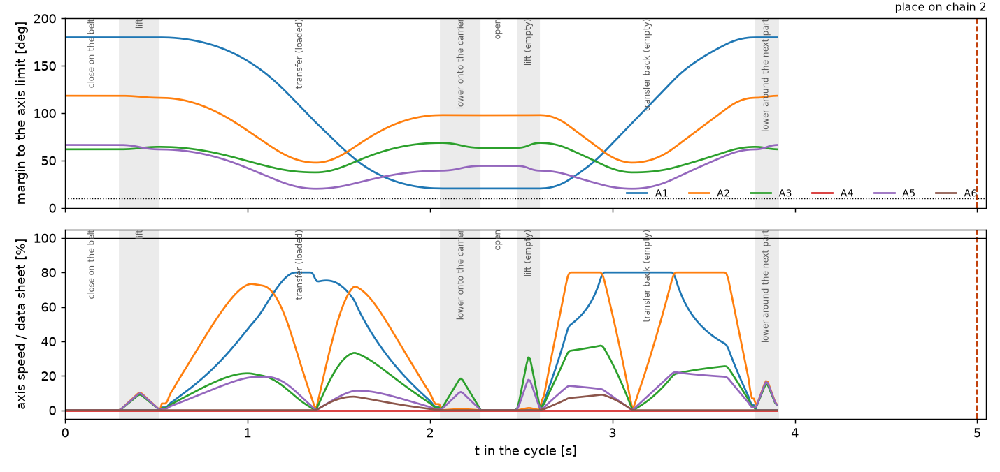

# E4 - MuJoCo cell and grip validation

ABB IRB 1300-7/1.4 on its pedestal, the gripper on the ISO 9409 flange, part B on the buffer belt and the
workpiece carrier. The model is generated from the sources, nothing is drawn by hand.

| File | Purpose |
|---|---|
| `export_meshes.py` | robot links (ABB STEP) and part B (FH STEP) as STL, `fc.sh export_meshes.py`; third-party, so `meshes/` is gitignored |
| `build_model.py` | MJCF from `06_Cell/cell_params.py` (layout, kinematics), the gripper build (`02_CAD_Body/out`) and the meshes |
| `sim.py` | poses from the closed-form IK, part placement in the jaws, rendering; `python sim.py` renders pick and place |
| `validate_grip.py` | grip validation over the real path, `python validate_grip.py` |
| `drive.py` | motor curve (ST4118S at 24 V from R, L, holding torque), reflected drive inertia, fastest move |
| `closing_time.py` | closing time and impact on the part, `python closing_time.py` |
| `power_fail.py` | power loss with the part in the jaws: detent only until the brake engages |
| `viz.py` | slow-motion video with four cameras, contact points and forces, clearance check (convex hulls) |
| `cell_video.py` | running cell at the 5 s takt: parts queue on the buffer line, the robot loads chain 2 and chain 1 in turn (chain 1 = mirrored E4 path), the carriers index into the machine; kinematic replay, [`figures/cell_takt.mp4`](figures/cell_takt.mp4) |
| `validation_notebook.py` | everything live: `marimo edit validation_notebook.py` |

**Model.** Robot joints follow the path through stiff position control with gravity compensation (the robot's own
dynamics are not the question here). The two jaws are slide joints driven together through a tendon (pinion and two
racks) by one position actuator whose force limit is 2 × the force per jaw: the current-limited motor. Rotor,
gearbox, brake and bevel pair sit on the slides as armature (3.2 kg reflected on the jaw coordinate, `drive.py`). NBR pad on
PA 6 with μ = 0.2 (oily part), elliptic friction cone, noslip solver. Part B as a free body, 0.602 kg, contact shape
from two boxes (body with the flat grip faces, lug) because its convex hull would touch the left pad.

**Path.** Pick on the belt, lift 60 mm in 0.4 s, transfer to the carrier in T_EINWEG = 2.0 s with a trapezoidal
profile in joint space (MoveJ), lower 60 mm. Axis 1 turns about 160°, so the TCP sees up to 5 m/s², not the 2.05 m/s²
of a straight 1.8 m line that the hand calculation assumes. E-stop (category 0): in the middle of the transfer every
axis brakes with its deceleration from the ABB product specification (3HAC070393 rev. M, p. 91: axis 1 55.25° in
0.40 s, i.e. 12.1 rad/s²), which gives 12.3 m/s² at the TCP; the brake locks the drive with the preload kept.

**Results, 20 Nov 2026** (`out/grip_results.json`, `figures/grip_slip.png`), on the transfer through the vias
(the 1200 mm enclosure, see below) at the time law with TCP acceleration <= 4.96 m/s2 (the simulated robot
following it shows peaks of 6.4 m/s2, 7.0 in the e-stop: servo response at the via; the friction use includes it). Friction use = |vector sum
of the pad friction forces| / (μ ΣF_n), median over the moving phases and 50 ms peak.

| Case | Force per jaw | friction use median / peak | part movement (raw / beyond creep base) | |
|---|---|---|---|---|
| required (hand calc., 2.05 m/s²) | 35.7 N | 0.42 / 0.81 | 2.37 / +0.02 mm | held |
| no safety (F / S) | 17.9 N | - / 1.00 | dropped | expected: sized for 2.05 m/s², the path needs 4.96 |
| **setpoint** (real path 4.96 m/s²) | 44.5 N | 0.34 / 0.72 (S_eff 1.38) | 2.36 / +0.01 mm | held |
| e-stop at required, ABB category 0 | 35.7 N | 0.41 / 0.81 | 2.35 / +0.02 mm | held |
| e-stop at setpoint | 44.5 N | 0.33 / 0.72 | 2.35 / +0.01 mm | held |

**Creep base.** On the via path the part creeps 2.3-2.4 mm along the pads whatever the grip force: 25, 35.7, 44.5,
48.5 and 100 N per jaw all give the same movement, a finer time step gives more (1 ms 1.72, 0.5 ms 2.38, 0.25 ms
2.70 mm), a 100 x stiffer contact impedance only 1.72 mm, the friction cone (elliptic / pyramidal, condim 3/4/6)
and noslip iterations change nothing essential. Real slip would shrink with the grip force, so this is the soft
contact model, not the grip. Slip is therefore measured beyond a reference run at 100 N per jaw on the same path
(`creep_base`), limit 0.5 mm. Two pad springs (NBR shear, `build_model.py`) now share the tangential load between
the pads as the rubber does: before, one pad sat at its friction limit while the other pulled the other way.

Hand calculation at each instant (`validate_grip.quasi_static`, `friction_check`, `out/friction_check.json`): the
pads must carry m (a - g) in their plane, with a from the simulated part motion. Median friction use over the
transfer, quasi-static vs simulated: required 0.420 / 0.420, setpoint 0.338 / 0.338, e-stop 0.332 / 0.332 (within
0.1 %): the V2 model is validated. Short peaks on the via path: simulation 0.72 ... 0.81 against 0.47 ... 0.58
quasi-static; the fast axis 1 turn on the small radius adds dynamics the hand formula does not contain. The setpoint
covers it (peak 0.72).

## Enclosure and transfer path (`clearance.py`, `sim.transfer_path`, `sim.TimeLaw`)

Abb. 1: the enclosure is 1200 mm wide (y = ±600) and 2100 mm high. A plain joint swing pick -> place takes the
forearm 318 mm through the fence. One via in the middle of the swing, where the arm points at the fence (axis 1 at
90°, wrist pulled in to 350 mm at 1700 mm height); axis 1 keeps turning through it while the arm pulls in and
reaches out again, interpolated shape-preserving (PCHIP, no axis overshoots between the waypoints). Rejected: two
retracted vias with a cubic spline (axis 5 overshot to 7° from its limit) and with PCHIP (a stop at each via,
cycle 5.3 s). The time law is the fastest with the TCP acceleration (tangential + centripetal) below 4.96 m/s2
loaded / 15 m/s2 empty and every axis below 80 % of its speed.

## E4: the full cycle measured (`e4_cycle.py`, `out/e4_cycle.json`, `out/e4_collision_log[_chain1].csv`)

The robot loads both chains in turn: chain 2 (y = +300) through the via at axis 1 = +90°, chain 1 (y = -300) through
its mirror image at -90°. At the place, axis 6 turns by -20.6° (chain 2) / +20.6° (chain 1) so part B lands square
on the carrier (yaw 180°); with axis 6 at 0 it would land 20.6° skewed (`sim.q_place`). Both cycles are timed and
checked; they are identical in time.

| Phase | Duration |
|---|---|
| close on the belt (two-stage, grip force stands after 0.263 s) | 0.30 s |
| lift 60 mm (loaded) | 0.22 s |
| transfer through the via (loaded) | 1.54 s |
| lower onto the carrier | 0.22 s |
| open | 0.20 s |
| lift (empty) | 0.13 s |
| transfer back (empty) | 1.18 s |
| lower around the next part | 0.13 s |
| **cycle** | **3.91 s of 5.0 s** |

Collision log every 10 ms, robot links 2-6 and the gripper against every obstacle (convex hulls, on the safe side):
no contact anywhere, on either chain. Closest: fence 100 mm (chain 2) / 117 mm (chain 1), both on the empty way
back near the via (the gripper is not mirror-symmetric), production line 153 mm, chain / carrier on the other chain
453 mm, pedestal 434 mm, belt 94 mm while carrying the part off; the 34 mm to belt and carrier are the jaws at the part while picking and
placing, 64 mm the jaw to the near chain. Axes: smallest margin to a limit 20.3° (axis 5) and 20.6° (axis 1 at the
place position), speeds at most 80 % of the data sheet (axes 1 and 2 on the empty way back).

## Closing time (`closing_time.py`, `out/closing_results.json`, `figures/closing.png`)

Requirement from the hand calculation V2: close 8 mm per jaw and have the grip force within 0.3 s. The drive runs
position controlled with the current limit as grip force (setpoint 44.5 N per jaw). Motor curve from the datasheet's electrical
values at 24 V (phasor sum of back-EMF and winding impedance), 70 % usable in closed loop; the Nanotec curve still
has to be laid over it.

| Profile | contact | grip force within 5 % | peak pad force | motor peak |
|---|---|---|---|---|
| direct, trapezoid 0.25 s | 177 ms at 51 mm/s | 195 ms | 73.0 N (1.4 ×) | 324 rpm, 0.018 of 0.136 N·m |
| direct, trapezoid 0.12 s | 86 ms at 109 mm/s | 100 ms | 138.7 N (3.0 ×) | 675 rpm, 0.030 of 0.136 N·m |
| two-stage: 0.12 s to 1 mm before the part, then 10 mm/s | 173 ms at 10 mm/s | 263 ms | 45.3 N (1.0 ×) | 591 rpm, 0.028 of 0.136 N·m |

- Torque is not the limit: the motor could cover the 8 mm in 45 ms. The motor uses at most a quarter of its torque.
- The limit is the impact. Rotor, gearbox and brake act like 3.2 kg on the jaws, seven times the jaws themselves
  (0.47 kg), and the current limit cannot stop this inertia before the pads hit: driving straight in at 50 mm/s
  gives 77 N, more than the FEM's full-current case (63.6 N); the undamped estimate with a 3 mm NBR pad is even
  higher (`impact_estimate`, no damping, upper bound).
- **Recommendation:** two-stage profile, fast to 1 mm before the part and the last millimetre at 10 mm/s
  (NanoJ program or two position records in the CL4-E). Meets 0.3 s with 45 ms to spare, no force overshoot.
- The MuJoCo contact stiffness is not calibrated to the pad; the peaks are a comparison between the profiles,
  the order of magnitude is backed by the estimate.

## Videos

`viz.py` renders any run in slow motion with four cameras (cell; both jaws with the housing see-through; pad close-up;
back view on the lug side), contact points and forces split into normal and friction, and a clearance check between
the part and the jaws, pad plates, holders, cover and housing, and between gripper / robot and belt, carrier and
pedestal (convex hulls, so conservative). Colliding parts turn red; the HUD shows pad forces, friction use and
part movement. [`figures/closing_direct_120ms.mp4`](figures/closing_direct_120ms.mp4), [`figures/closing_two-stage_120ms.mp4`](figures/closing_two-stage_120ms.mp4) at 0.05 ×, [`figures/cycle_estop.mp4`](figures/cycle_estop.mp4) at 0.25 ×; in the notebook with your own values.

## Power failure (`power_fail.py`, `out/power_fail.json`, `figures/power_fail.png`)

The robot holds the part above the belt at the setpoint (44.5 N per jaw), then the drive loses power: only the
stepper's detent torque is left (6 mN·m → 1.9 N per jaw), until the spring-applied brake locks the drive.

| brake engages after | pad force left | part |
|---|---|---|
| 0 ms (drive holds until the brake is closed) | 44.5 N | held |
| 2, 5, 10, 20, 50 ms | 0 N | **dropped** (58 mm, onto the belt) |

The part needs 14.8 N per jaw against its weight; the elastic preload of pads, jaws and slides opens the jaws within
about 2 ms. No spring-applied brake is that fast, so the brake alone does not hold the part: the controller must keep
the motor powered until the brake has closed. Remedy in D11 (`02_CAD_Body/CAD_PLAN.md`): 24 V buffer module (PULS
UF20.241) and a brake-first shutdown in the NanoJ program. Gearbox friction is left out (conservative).

## Looks of the cell (NVIDIA SimReady, CC-BY-4.0)

Belt, fence and floor are NVIDIA SimReady assets (`06_Cell/simready`: `fetch.py` downloads them into the
git-ignored `06_Cell/vendor/simready`, `usd2obj.py` converts them in Blender, `derived.py` adapts them, `layout.py`
scales and places them onto the exact cell geometry). They are visual only: the collision check and the physics use
the plain boxes from `cell_params.py` (Abb. 1), which stay underneath. Without the downloaded assets the model falls
back to the boxes. The buffer belt is the flat belt `warehouse_conveyorBelt_a06`; the catalogue only has chain
modules with legs at one end, so `derived.py` mirrors the leg pair and cuts the posts at the belt top. Fence
`wire_machineGuard_a04`, floor `environment_floor_a01`, © NVIDIA, https://huggingface.co/datasets/nvidia/simready-assets.
Own visual parts (`cell_parts.py`): a CNC machining centre (finishes slot and bore of part B) closes the place
side and takes both carrier chains through inlets; the chains run as in Abb. 1 (carriers fixed to the chain, top
run into the machine, return underneath, end sprocket). The buffer line housing closes the pick side, the belt leaves
it through an 850 mm hood (ISO 13857: no reach through the 110 mm slot). Mesh panels fill the gaps, so the
enclosure is closed all round; the door with guard locking sits on the operator side next to the switch cabinet.
E4 and the grip validation use the same poses (`sim.q_place`). The switch cabinet with the OmniCore C30 on top (449 x 443 x 170 mm per the ABB brochure) is modelled in
`derived.py` with drawn front textures (C30 front, door with warning sign, labels, pilot lights, E-stop, main switch).
