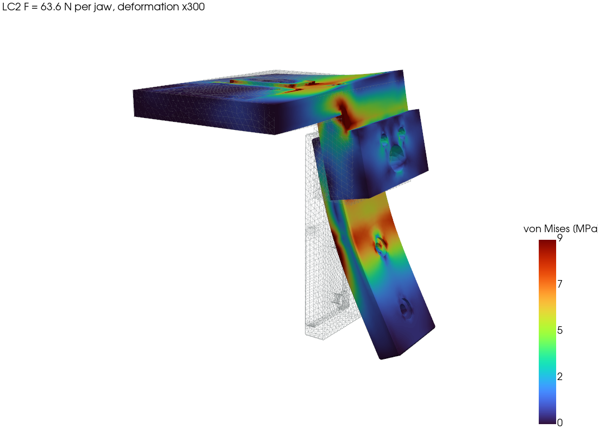

# E5 - FEM of the jaw

Scripted chain: `jaw.step` -> gmsh (C3D10) -> CalculiX -> matplotlib / PyVista. No GUI tool needed.

| File | Purpose |
|---|---|
| `fem_jaw.py` | mesh, boundary conditions, solve, read results; `python fem_jaw.py` runs the mesh convergence study |
| `fem_notebook.py` | interactive: pick load case, element size, clamp; `marimo edit fem_notebook.py` |
| `analytic.py` | beam-theory cross-check (Euler-Bernoulli + shear); the graded hand calculation is V4 |
| `export_jaw.py` | regenerates `jaw.step` from the CAD parameters (FreeCAD: `fc.sh export_jaw.py`) |
| `figures/` | convergence plot, von Mises and deflection images |

Setup: `pip install gmsh pyvista marimo matplotlib numpy`. CalculiX comes with FreeCAD 1.1
(`bin/ccx.exe`); otherwise set the `CCX` environment variable.

**Model.** Holder face (x = 44, z = -47 ... -28.5) fixed in x only, dowel holes fixed in y and z,
grip force as uniform pressure on the pocket floor (x = 39). EN AW-7075 T6, E = 71.7 GPa, Rp0.2 = 460 MPa.

**Results, 11 Nov 2026, F = 63.6 N (full current):**

| | FEM (158k el.) | beam theory | |
|---|---|---|---|
| bending stress at z = -53.5 | 5.71 MPa | 5.73 MPa | -0.3 %, converged |
| deflection at load centre | 17.0 µm | 11.6 µm | +47 %; rigid clamp in FEM: 15.0 µm |
| peak von Mises | ~20 MPa | - | sharp pocket corner, grows with refinement |

- The stress matches within 0.3 % from 9k elements on. The ≤ 5 % criterion is met on stress.
- The deflection gap is the classic clamp question: beam theory assumes a rigid clamp at the holder
  edge, the real jaw also deforms inside the holder zone and around the holes. The printed check (V5) decides.
- The peak sits on the sharp edge between pocket wall and rim and is a singularity. A milled pocket has a
  corner radius anyway; with R1 in the CAD it converges. Safety is > 20 against Rp0.2 either way.

## Next: jaw train (slide + jaw holder + mock jaw), prepared 16 Nov 2026

The jaw is a mock until Viktoriia's jaw (V3) exists; it carries the pad load into the holder at the right place,
so holder and slide see their real loads. When V3 arrives only `export_train.py` changes.

| File | Purpose |
|---|---|
| `load_cases.py` | load cases, materials, required safety, acceptance criteria; `python load_cases.py` prints the table |
| `export_train.py` | slide + holder + mock jaw of the right side as `train.step` (`fc.sh export_train.py`) |
| `fem_train.py` | mesh once, solve LC1-LC5, results JSON + LC2 figure; `python fem_train.py [element size]` |
| `fem_train_notebook.py` | results table, safety and tilt plots, run button; `marimo edit fem_train_notebook.py` |

**Load cases** (per jaw, at the pad centre; generated by `load_cases.py`):

| Load case | Fx [N] | Fy [N] | Fz [N] | S req. | Meaning |
|---|---|---|---|---|---|
| LC1 nominal grip | 35.7 | 0.0 | 0.0 | 2.0 | required grip force, oily part, mu 0.2, S 2 |
| LC2 full current | 63.6 | 0.0 | 0.0 | 2.0 | motor at full current, end stop or part |
| LC3 transport | 35.7 | 0.6 | -3.6 | 2.0 | LC1 plus the part's weight and path acceleration carried by friction |
| LC4 emergency stop | 63.6 | 3.6 | -6.6 | 1.5 | LC2 plus the part decelerating at 12.1 m/s² (ABB category 0 stop data, axis 1 at 1.0 m) |
| LC5 brake limit | 123.7 | 0.0 | 0.0 | 1.2 | power off, jaw pushed until the brake slips (misuse / collision) |

**Model.** Slide fixed on its contact patch with the ball carriage (carriage taken as rigid), slide - holder and
holder - jaw bonded (preloaded screws and dowels), load as uniform traction on the pad area. EN AW-6082 T6 for
slide and holder (Rp0.2 250 MPa), EN AW-7075 T6 for the mock jaw (460 MPa).

**Acceptance.** von Mises below Rp0.2 / S per load case (125 MPa for 6082 at S 2); pad tilt ≤ 0.1° in LC2 so the
pads stay flat on the part (the deflection at the pad centre is reported but not governing); fatigue: LC1 is a
pulsating load at about 3 million cycles a year, stress amplitude ≤ 45 MPa in 6082.

**Results, 16 Nov 2026** (`fem_train.py`, element size 2 mm, 65.7k C3D10; 3 mm gives the same deflection within
0.2 %, peak stresses +10 %, they sit at hole edges and grow slowly with refinement):

| Load case | u pad [µm] | tilt [°] | slide [MPa] / S | holder [MPa] / S | mock jaw [MPa] / S |
|---|---|---|---|---|---|
| LC1 nominal grip | 36.2 | 0.050 | 8.9 / 28.0 | 9.3 / 26.9 | 9.8 / 46.9 |
| LC2 full current | 64.5 | 0.089 | 15.9 / 15.7 | 16.5 / 15.1 | 17.5 / 26.3 |
| LC3 transport | 36.4 | 0.050 | 9.0 / 27.8 | 9.4 / 26.7 | 10.0 / 46.2 |
| LC4 emergency stop | 65.4 | 0.090 | 15.9 / 15.7 | 17.4 / 14.3 | 17.7 / 25.9 |
| LC5 brake limit | 125.4 | 0.173 | 30.9 / 8.1 | 32.2 / 7.8 | 34.0 / 13.5 |

- Strength is far from critical: S ≥ 7.8 in every part and load case, also at the brake limit.
- Fatigue: LC1 amplitude in the holder about 4.7 MPa against 45 MPa allowed.
- Stiffness is the design driver: the slide's overhang beyond the carriage bends under the 60 mm lever from the pad,
  holder and jaw tilt almost as a rigid body. LC2 tilt 0.089° meets 0.1° with only 11 % margin, and the carriage is
  taken as rigid here; its own tilting stiffness (Rexroth catalogue) will add to it. Next step: add the carriage
  compliance as a spring, and if the margin goes, make the slide thicker or move the holder closer to the carriage.

**To run** (on mains power, about 5 min at 3 mm): `fc.sh export_train.py`, then `python fem_train.py 2.0`,
or interactively `marimo edit fem_train_notebook.py` (shows the last results at once).
