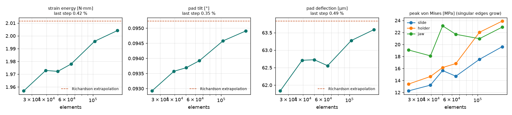

# E5 - FEM of the jaw

Scripted chain: `jaw.step` -> gmsh (C3D10) -> CalculiX -> matplotlib / PyVista. No GUI tool needed.

| File | Purpose |
|---|---|
| `fem_jaw.py` | mesh, boundary conditions, solve, read results; `python fem_jaw.py` runs the mesh convergence study |
| `fem_notebook.py` | interactive: pick load case, element size, clamp; `marimo edit fem_notebook.py` |
| `analytic.py` | beam-theory cross-check (Euler-Bernoulli + shear); the graded hand calculation is V4 |
| `export_jaw.py` | regenerates `jaw.step` from the CAD parameters (FreeCAD: `fc.sh export_jaw.py`) |
| `figures/` | convergence plot, von Mises and deflection images |

Setup: `pip install gmsh pyvista marimo matplotlib numpy`. CalculiX comes with FreeCAD 1.1
(`bin/ccx.exe`); otherwise set the `CCX` environment variable.

**Model.** Holder face (x = 44, z = -47 ... -28.5) fixed in x only, dowel holes fixed in y and z,
grip force as uniform pressure on the pocket floor (x = 39). EN AW-7075 T6, E = 71.7 GPa, Rp0.2 = 460 MPa.

**Results, 11 Nov 2026, F = 63.6 N (full current):**

| | FEM (158k el.) | beam theory | |
|---|---|---|---|
| bending stress at z = -53.5 | 5.71 MPa | 5.73 MPa | -0.3 %, converged |
| deflection at load centre | 17.0 µm | 11.6 µm | +47 %; rigid clamp in FEM: 15.0 µm |
| peak von Mises | ~20 MPa | - | sharp pocket corner, grows with refinement |

- The stress matches within 0.3 % from 9k elements on. The ≤ 5 % criterion is met on stress.
- The deflection gap is the classic clamp question: beam theory assumes a rigid clamp at the holder
  edge, the real jaw also deforms inside the holder zone and around the holes. The printed check (V5) decides.
- The peak sits on the sharp edge between pocket wall and rim and is a singularity. A milled pocket has a
  corner radius anyway; with R1 in the CAD it converges. Safety is > 20 against Rp0.2 either way.

## Next: jaw train (slide + jaw holder + mock jaw), prepared 16 Nov 2026

The jaw is a mock until Viktoriia's jaw (V3) exists; it carries the pad load into the holder at the right place,
so holder and slide see their real loads. When V3 arrives only `export_train.py` changes.

| File | Purpose |
|---|---|
| `load_cases.py` | load cases, materials, required safety, acceptance criteria; `python load_cases.py` prints the table |
| `export_train.py` | slide + holder + mock jaw of the right side as `train.step` (`fc.sh export_train.py`) |
| `fem_train.py` | mesh once, solve LC1-LC5, results JSON + LC2 figure; `python fem_train.py [element size]` |
| `fem_train_notebook.py` | results table, safety and tilt plots, run button; `marimo edit fem_train_notebook.py` |

**Load cases** (per jaw, at the pad centre; generated by `load_cases.py`):

| Load case | Fx [N] | Fy [N] | Fz [N] | S req. | Meaning |
|---|---|---|---|---|---|
| LC1 setpoint grip | 44.5 | 0.0 | 0.0 | 2.0 | operating grip force (real path, mu 0.2, S 2) |
| LC2 full current | 63.6 | 0.0 | 0.0 | 2.0 | motor at full current, end stop or part |
| LC3 transport | 44.5 | 1.5 | -4.4 | 2.0 | LC1 plus the part's weight and path acceleration carried by friction |
| LC4 emergency stop | 63.6 | 17.5 | -17.5 | 1.5 | LC2 plus the part's inertia at 82 m/s² (ABB e-stop design acceleration incl. gravity, spec p. 54) |
| LC5 brake limit | 123.7 | 0.0 | 0.0 | 1.2 | power off, jaw pushed until the brake slips (misuse / collision) |

**Model.** Slide fixed on its contact patch with the ball carriage (carriage taken as rigid), slide - holder and
holder - jaw bonded (preloaded screws and dowels), load as uniform traction on the pad area. EN AW-6082 T6 for
slide and holder (Rp0.2 250 MPa), EN AW-7075 T6 for the mock jaw (460 MPa).

**Acceptance.** von Mises below Rp0.2 / S per load case (125 MPa for 6082 at S 2); pad tilt ≤ 0.1° in LC2 so the
pads stay flat on the part (the deflection at the pad centre is reported but not governing); fatigue: LC1 is a
pulsating load at about 3 million cycles a year, stress amplitude ≤ 45 MPa in 6082.

**Model since 19 Nov 2026.** Jaw = Viktoriia's V3 (`v3_import.py` builds `train_v3.step` and `jaw_v3.step` from
`Viktoriia/03_CAD_Jaws/jaw_R.step`, moved from the grip position to d = 0). Supports corrected: the carriage holds
the slide in y and z only (it runs along x on the rail), the grip force goes into the rack, modelled as a rigid body
(pin bore + the boss the rack sits on) held in x at the pitch line of the pinion mesh. Before, the carriage patch
was fixed in x too, which put the rack's job on the carriage.

**Results, 21 Nov 2026, T-shaped jaw** (`fem_train.py`, 2 mm, 77k C3D10). Review 21 Nov: part B's centre of mass
sat 19 mm under the pad centre, so a path acceleration along the pads twisted the part in the jaws and the friction
had to carry that moment as well (`02_CAD_Body/grip_check.py`). Part B now sits 15 mm higher (jaws 15 mm shorter),
the pad is 80.8 x 19.8 mm instead of 21.8 x 33.8 mm, low on the flat zone between the lug and the roof chamfer, on an
88 mm wide plate under the unchanged 25 mm web:

| Load case | u pad [µm] | tilt [°] | slide [MPa] / S | holder [MPa] / S | jaw V3 [MPa] / S |
|---|---|---|---|---|---|
| LC1 setpoint grip | 29.2 | 0.041 | 9.6 / 26.1 | 10.8 / 23.2 | 5.8 / 79.8 |
| LC2 full current | 41.8 | 0.059 | 13.7 / 18.2 | 15.4 / 16.2 | 8.2 / 55.8 |
| LC3 transport | 29.5 | 0.042 | 9.6 / 25.9 | 11.2 / 22.4 | 6.0 / 76.8 |
| LC4 emergency stop | 45.3 | 0.062 | 15.2 / 16.4 | 20.1 / 12.5 | 10.6 / 43.3 |
| LC5 brake limit | 81.3 | 0.114 | 26.7 / 9.4 | 30.0 / 8.3 | 16.0 / 28.7 |

- Strength is far from critical: S ≥ 8.3 everywhere, also at the brake limit.
- Stiffness drives the design: LC2 tilt 0.059° against 0.1° (0.091° with the old jaw: the shorter lever helps more
  than the heavier plate costs). The carriage is still rigid in the model; its own tilting stiffness (Rexroth
  catalogue) is the next thing to add.

**Mesh convergence** (`convergence.py`, LC2, down to 1.2 mm = 199k elements, `figures/convergence_train.png`):
strain energy, pad tilt and pad deflection change by 0.60 / 0.53 / 0.20 % in the last refinement (converged:
1.308 N·mm, 0.059°, 41.9 µm). Peak von Mises at hole and support edges keeps growing (singular), so it is reported
but not used for a verdict; the safety factors above leave room for a factor of 8 on it.

## V4 check: Viktoriia's beam theory against the FEM of her jaw V3 (`v4_check.py`)

Her notebook is executed as it is; FEM of `jaw_v3.step` at full current, 2.5 / 1.6 / 1.0 mm (deflection changes
0.3 % in the last step). Interactive with all plots: `marimo edit review_viktoriia_notebook.py`.

| Quantity | V4 | FEM (105k el.) | deviation | ≤ 5 % |
|---|---|---|---|---|
| bending stress at z = -53.5 (mean over the web width) | 4.18 MPa | 4.07 MPa | +2.6 % | ✓ |
| deflection, rigid beam (a+b) vs FEM clamped section at z = -47 | 3.64 µm | 4.15 µm | -12.3 % | ✗ |
| deflection, beam + Weber (a+b+c) vs FEM rigid clamp | 5.43 µm | 5.82 µm | -6.7 % | ✗ |
| deflection, beam + Weber vs FEM standard support | 5.43 µm | 6.96 µm | -21.9 % | ✗ |

The stress is confirmed. It is read as the mean over the whole web width: the load enters the 25 mm web from the
88 mm plate mainly along the web edges, so a strip in the middle reads about 6 % low, while the width mean meets beam
theory within 0 ... 2 % all along the web (`fem_jaw.py`, check over z = -48 ... -57). The deflection is not within
5 %: the beam variants give 3.6 ... 5.4 µm against 4.2 ... 5.8 µm in the FEM; the rest is the clamp zone and the
web-plate junction, which a beam does not see. Weber's term comes from gear-tooth roots and is an estimate of the
elastic clamp, not a proof. At about 5 µm the jaw deflection is far from mattering; the tilt above is the criterion.
`jaw_variants.py` is the study for the previous bar-shaped jaw (pocket rims, 20 Nov) and is not rerun.

**To run:** `python v3_import.py`, `python fem_train.py 2.0`, `python convergence.py`, `python v4_check.py`;
solver files are deleted after reading (`KEEP_FILES=1` keeps them), the results live in `out/*.json`.
