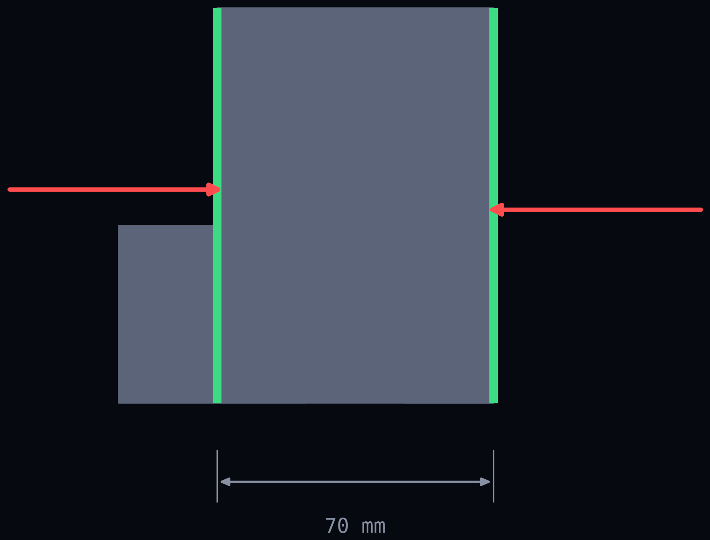
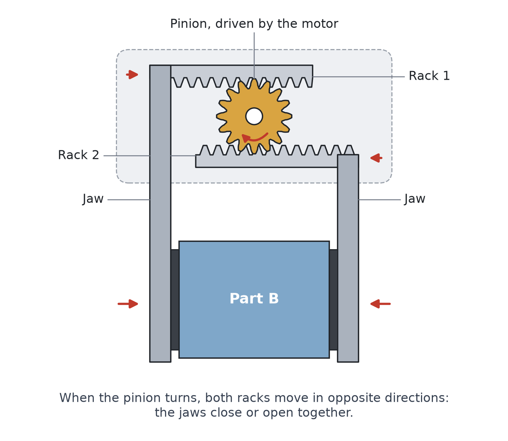

# Robot Gripper - Part B

A two-finger gripper and the robot cell around it, designed as a semester
project for *Produktdesign und Produktentwicklung*, MRE WS 2026/27.

A robot picks a PA 6 part off a buffer belt at 1000 mm, carries it 1800 mm and
places it on a workpiece carrier at 1300 mm. Cycle time is 5 seconds per part.
The part is given; the gripper is not. Submitted is the whole cell: gripper on
the robot, robot in the cell with safety fence, buffer belt and workpiece
carrier, plus motion and grip analysis.

**Team:** Bitsch Elias · Ovdiienko Viktoriia - Group 10
**Plan:** [PLAN.md](PLAN.md) · **Status (23 Nov 2026):** design built and proven in simulation and FEM; interim report
3 Dec 2026, final review 22 Jan 2027. Current state and open points: [docs/HANDOVER.md](docs/HANDOVER.md)

---

## 🔩 The part

| | |
|---|---|
| Bounding box | 95 × 100 × 80 mm |
| Volume | 528.5 cm³ |
| Material | PA 6, ρ = 1140 kg/m³ |
| Mass | 0.602 kg |
| Surface | Ra 1.6 |

Two flat, parallel side faces 70 mm apart, 6200 mm² on the smaller side. The
assignment allows gripping **from the side only** - no undergripping on the
belt, which rules out both a vacuum cup and anything that reaches underneath.



---

## The concept

A **2-finger parallel gripper** with **rack and pinion**: a closed-loop stepper with planetary gearbox,
zero-backlash holding brake and a 1:1 spiral bevel pair turns a pinion between two racks; each rack carries one
jaw slide on a miniature ball rail.

The design takes **one half** of the
[Cartesian Hand](https://arxiv.org/abs/2609.25696) (Duke, 2026,
[video](https://www.youtube.com/watch?v=ktNcPPTPsQE)): one of its two parallel
grippers, without the second gripper and without the fingertip slides along
the fingers.



Why rack and pinion:

- Jaws move in a **straight line** and stay parallel - no scrub on Ra 1.6
- **Constant jaw force** over the whole stroke, no transmission angle to prove
- One gear mesh to calculate; one shared ball rail (Rexroth size 12) keeps both jaws parallel

The rack is **back-drivable**, so a permanent-magnet holding brake (Nanotec BKE-0,4-5,0, zero backlash) keeps
the jaws closed on power failure. The jaws change without tools: two dowel pins locate them, a knurled thumb screw
holds them.

The design is industrial: milled aluminium housing, catalogue rack and pinion
in steel, a 24 V closed-loop stepper with gearbox and zero-backlash brake. The Cartesian Hand is the model for the
principle, not for material or drive.

**Required gripping force:** 35.7 N per jaw by hand calculation (µ = 0.2 for an oily part, safety factor 2.0,
path acceleration 2.05 m/s² out of the cycle-time budget); operating setpoint **44.5 N** for the real path
(4.96 m/s²), with the part's twist checked in `Elias/02_CAD_Body/grip_check.py`. The early 14.3 N (µ = 0.5, dry)
is superseded.

---

## 🤖 The cell

Robot is an **ABB IRB 1300-7/1.4** (since 10 Nov 2026; before IRB 1600-6/1.45). With the IRB 1600 the sequence was
not executable from the floor because of axis 5 (±115°); the IRB 1300 has ±130° and stays below 91°, so a pedestal
from 200 mm on works (12.5° axis margin, arm 92 % stretched). We keep **500 mm plus a 100 mm base offset** toward the
workpiece carrier for more margin (20.6°, 74 % stretched). Placement study: `Elias/01_Robot`.

---

## 🛠 Toolchain

| Tool | Used for |
|---|---|
| **FreeCAD / CadQuery (scripted)** | gripper assembly, jaws, cell assembly, drawing views |
| **marimo / Python** | sizing (V2), analytical strength (V4), validation notebook with live preview |
| **MuJoCo** | cell, motion sequence, collision check, grip, closing, e-stop, Monte Carlo robustness |
| **gmsh / CalculiX** | FEM of the jaw, compared against the hand calculation (within 5 %) |
| **Onshape** | early concept sketches and PLM exercises |
| **FDM printing (planned, V5)** | a printed jaw and a friction test of the pad, as extra data points |

---

## Repository layout

```
├─ Elias/            system & numerical proof
├─ Viktoriia/        design & analytical proof
├─ shared/
│  ├─ submission/    final structure per Fig. 2 - German names, prescribed
│  └─ references/
├─ cad/ fem/ sim/    preliminary script chain, kept as reference
└─ PLAN.md
```

Each of us commits only inside our own folder, so there are no merge conflicts.
Merging happens once, at the end, in `shared/submission/`.

The four folder names under `shared/submission/` stay German on purpose - the
assignment prescribes that structure verbatim.

---

## 📅 Dates

| | |
|---|---|
| Design freeze | 4 Oct 2026 |
| Interim report | **3 Dec 2026** (BB-2) |
| Final review | **22 Jan 2027** (BB-2) |

Both run on the BB-2 dates (decided 19 Oct 2026, see PLAN.md).

---

## Grading

100 points across nine packages. The 3D design carries 20 on its own, every
other package 10. The full breakdown, the milestone plan and the open questions
are in [PLAN.md](PLAN.md).
