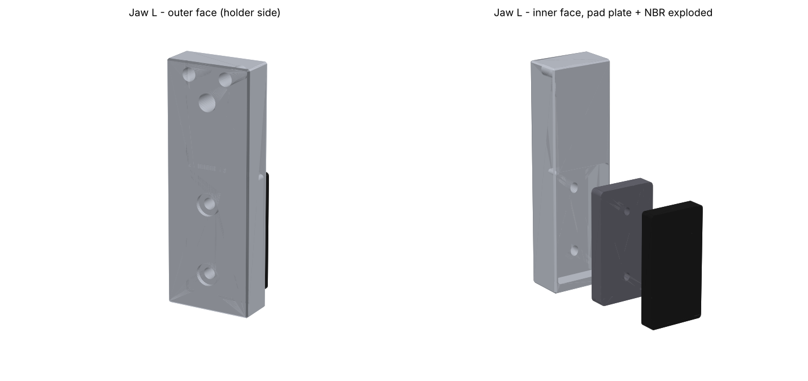

# V3 - Jaws and pad plates

Status 21 Nov 2026. Option **a)**: designed to Elias' frozen jaw interface (handover § 4).

**Change 21 Nov (review, Elias): T-shaped jaw with a wide, low pad.** Part B's centre of mass sat 19 mm under the
pad centre, so an acceleration along the pads twists the part in the jaws and the friction has to carry that moment
too; with the old 21.8 mm wide pad the e-stop needed 85 N per jaw (`Elias/02_CAD_Body/grip_check.py`). Part B now
sits 15 mm higher in the gripper, the jaw is 15 mm shorter, and the pad is 80.8 x 19.8 mm on an 88 mm wide plate
under the unchanged 25 mm web: CoG 10.5 mm under the pad centre, path case 37.8 N instead of 51 N per jaw. The
quick-change seat at the top is unchanged. The render below still shows the old jaw.

| File | Part | Material | Mass |
|---|---|---|---|
| `jaw_L.step`, `jaw_R.step` | jaw (R = mirror of L) | EN AW-7075 T6 | 54.4 g |
| `pad_plate_L.step`, `pad_plate_R.step` | pad plate, 2 x M3 thread | S235, 3 mm | 39.8 g |
| `pad_NBR_L.step`, `pad_NBR_R.step` | pad, vulcanised on the plate | NBR 70 Shore A, 3 mm, oil resistant | 6.2 g |
| `jaws_V3_assembly.step` | all six, coloured | | |
| `jaws.py` | CadQuery script, reads `gripper_params.py` | | |

All parts sit in the gripper frame at the grip position (d = 2 mm), so they replace the placeholders in
`gripper_assembly.step` one to one. Regenerate: `pip install cadquery`, then `python jaws.py`.

## Interface

- web 25 x 8 mm from the top (z = -28.5) to z = -56.5, plate 88 x 27.5 x 8 mm below (to z = -84), fillets R4;
  outer face on the holder from the top edge down to 18.5 mm (unchanged)
- 2 x O4 H7, 6.5 deep, y = +-5.5, 3.5 below the top (dowels ISO 8734 4 m6 x 12)
- O5.2, 6 deep, y = 0, 10.5 below the top (indexing plunger GN 617-5-A)
- pocket 82 x 21 x 3 mm, z = -60.5 ... -81.5; 2 x O3.4 through, side by side at y = +-28 at the pocket centre height

## What I changed inside the jaw

| Change | Why |
|---|---|
| Pocket corners **R1** (vertical edges) | a milled pocket has a radius anyway; removes the sharp notch that gave the non-converging FEM peak |
| **Counterbore O6.5 x 1** on the outer face at both M3 holes | the BOM has ISO 4762 **M3x6** (pos. 25): through 5 mm of jaw that leaves only 1 mm of thread in the 3 mm plate; with the counterbore it is 2 mm, and the screw still ends 1 mm before the rubber |
| Pad plate 81.8 x 20.8 mm, corners R1.5 | 0.1 mm clearance per side in the pocket, radius larger than the pocket's so it sits flat |
| NBR 0.5 mm smaller than the plate all round | vulcanising edge; contact area 80.8 x 19.8 = 1600 mm2, pressure < 0.05 MPa |
| outer edges 0.5 x 45, top face edges only deburred | deburring; a chamfer on the top edge left 1.0 mm above the O4 dowel holes, without it 1.5 mm (Elias, 20 Nov) |

The screws carry almost nothing: the grip force presses the plate into the pocket, and the pocket walls take the
friction force by form fit.

## Checks

- Collision check against all 105 solids of `gripper_assembly.step` (11 Nov): the new parts only overlap the
  placeholder jaw, plate and pad they replace - no contact with holder, dowels, plunger, slides or housing.
- V4 updated to the T-jaw (web 25 x 8, plate 88 x 8, pocket web 88 x 5 + 3 mm rims); stress vs FEM +2.6 %.
- Full CAD rebuilt with the T-jaw (21 Nov): no interference closed / grip / open, demo sequence clean.

## Open

- ~~Part B contour~~ checked by Elias (20 Nov) in the full CAD with part B: no interference closed / grip / open
  and through the whole demo sequence. Lead-in chamfer not needed: 8 mm clearance per side when open is more than
  the +-5 mm offset.
- Drawing of the pad plate ("bought to drawing") - comes with E3 / the drawing set.
