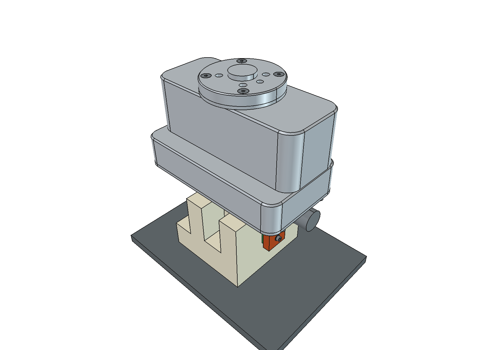
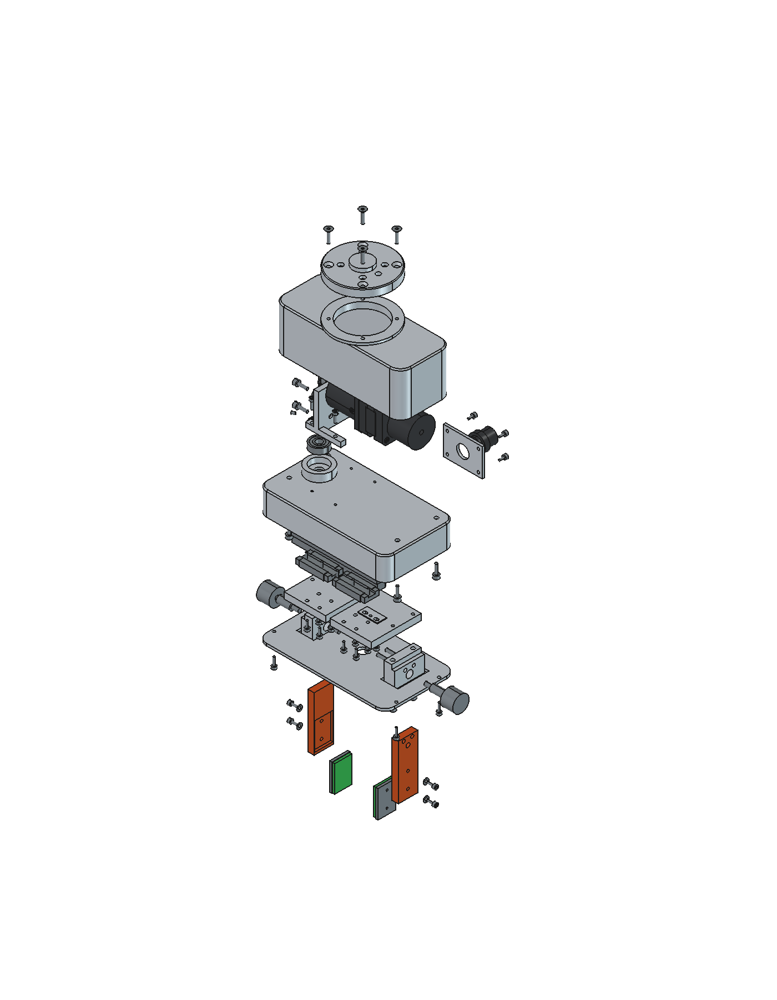
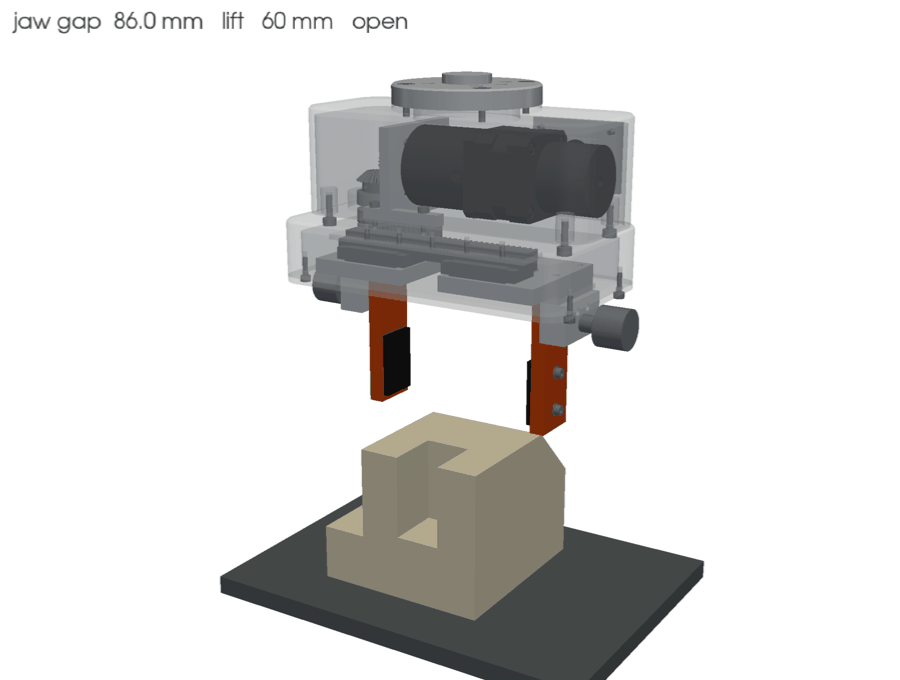
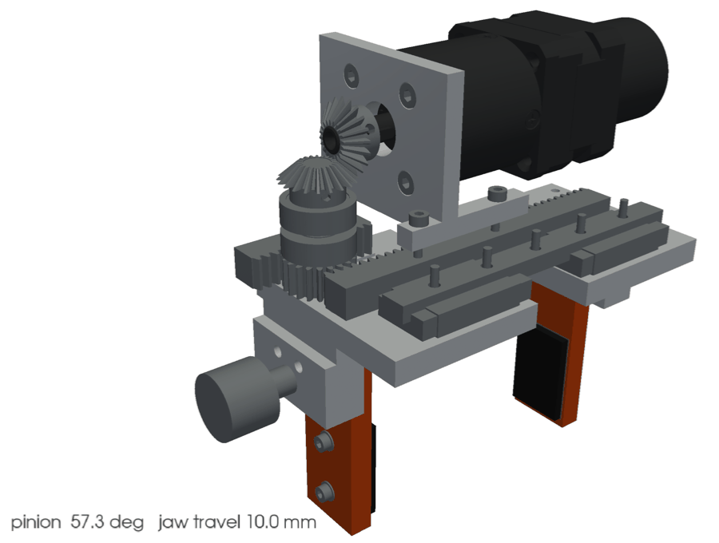
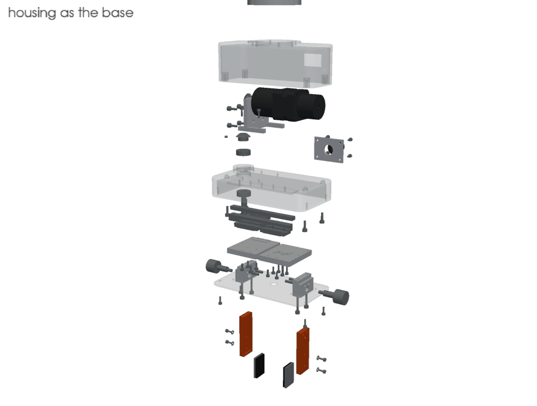

# Handover to Viktoriia - calculations, jaws, print check

Status of the gripper body: **11 Nov 2026**, branch `cad/freecad-gripper`, commit `707c09b`.
The body design (E2) is stable enough to calculate against. All values below come straight
from the CAD parameters; if you need a value that is missing, ask before assuming one.

 

**How it moves.** The stepper (with brake and planetary gearbox) drives a bevel pair, the bevel wheel sits on the
pinion shaft, and the pinion pushes two racks in opposite directions. Each rack carries a slide on a ball rail
carriage, and the jaw holder with the quick-change jaw is screwed to the slide. Pads turn green when the part is held.

| Pick and place cycle (housing see-through) | Drive train (housing, hood and cover hidden) |
|---|---|
|  |  |

Assembly order (animation)

The GIFs come from `Elias/02_CAD_Body/render_media.py` (PyVista, headless) and are regenerated after every CAD build.

## 1. Files

| What | File | Note |
|---|---|---|
| Full gripper assembly | [cad/gripper_assembly.step](cad/gripper_assembly.step) | 92 solids at grip position (d = 2 mm); part B is not included (FH data, take it from Moodle) |
| Jaw with pad plate and pad (left) | [cad/jaw_L.step](cad/jaw_L.step) | reference for V3/V4, right jaw is mirrored |
| Jaw interface (left) | [cad/jaw_interface_L.step](cad/jaw_interface_L.step) | holder + 2 dowels + indexing plunger + jaw |
| Drive train | [cad/drive_train.step](cad/drive_train.step) | pinion shaft, racks, bevel gears, 608 bearings, slides, carriages, rail |
| Bill of materials | [bom.csv](bom.csv) | 31 items, materials, masses, suppliers |
| Gripper parameters | [../../Elias/02_CAD_Body/gripper_params.py](../../Elias/02_CAD_Body/gripper_params.py) | all dimensions and catalogue data |
| Part, cell and force inputs | [../../cad/params.py](../../cad/params.py) | part mass, cycle time, acceleration, safety factor |
| Design decisions | [../../Elias/02_CAD_Body/CAD_PLAN.md](../../Elias/02_CAD_Body/CAD_PLAN.md) | D1-D10, manufacturing and assembly order |
| Catalogue sources | [../../Elias/02_CAD_Body/vendor/SOURCES.md](../../Elias/02_CAD_Body/vendor/SOURCES.md) | links to the data sheets |
| Calculation template (marimo, units, live recalculation) | [../calc_template/demo.py](../calc_template/demo.py) | `pip install marimo pint matplotlib`, then `marimo edit demo.py` |
| Live to-do list with timeline (tick items off there) | https://claude.ai/artifact/3gQTn4NuiM27SdwwwSC6XU#viktoriia | shared with you as editor |
| FEM pipeline (gmsh + CalculiX), to play with | [../../Elias/05_FEM/](../../Elias/05_FEM/README.md) | `marimo edit fem_notebook.py`: change load, mesh, clamp and compare with your V4 |
| Existing force estimate | [../../Viktoriia/02_Sizing/greifkraft_abschaetzung.tex](../../Viktoriia/02_Sizing/greifkraft_abschaetzung.tex) | starting point for V2, still with mu = 0.5 |

Frame used everywhere: z = 0 is the underside of the housing top plate, X = grip axis,
Y = 0 through the jaws and the flange axis. d = travel per jaw from the closed end stop.

## 2. Frozen input values

**Part and cycle**

| Quantity | Value |
|---|---|
| Part B mass (PA 6, 528.5 cm³) | 0.602 kg |
| Gripped width / contact area | 70 mm / 6200 mm² |
| Cycle time | 5 s, of which 2.0 s per transfer move |
| Path acceleration / peak speed | 2.05 m/s² / 1.37 m/s |
| Safety factor (VDI 2860) | S = 2 |
| Friction NBR pad on PA 6, **oily part** | mu = 0.2 (design value, source needed) |
| Robot | ABB IRB 1300-7/1.4, gripper mass 2.54 kg, COG 67 mm below the flange |

**Drive**

| Item | Data |
|---|---|
| Motor | Nanotec ST4118S1404-B, holding torque 0.20 Nm |
| Gearbox | Nanotec GP42-S1-7-SR, i = 7.07, eta = 0.90, perm. shaft load 305 N radial / 890 N axial |
| Brake | Nanotec BRAKE-BWA-0,35-5, 0.35 Nm, spring-applied, 24 V |
| Bevel pair | Mädler m = 1, z = 20, i = 1, b = 5 mm, C45 |
| Pinion | m = 1, z = 20, d = 20 mm, b = 10 mm, on the shaft, 16MnCr5 case hardened |
| Racks | Mädler m = 1, 10 x 12 mm, C45, 35 and 14 teeth (different lengths, offset pinion) |
| Bearings | 2 x DIN 625 608-2Z (8 x 22 x 7), centres at z = 3.5 and z = 13 |
| Pinion mesh | teeth z = -11 ... -1 (load at z ≈ -6, overhung below the lower bearing) |
| Bevel mesh | on top of the shaft, contact roughly at z ≈ 24 (check in drive_train.step) |
| Guide | Bosch Rexroth ball rail size 9, carriage SLS R0444 913 01: C0 = 3150 N, MT0 = 14.5 Nm, ML0 = 14.0 Nm |
| Rail position | y = -32.5, carriage centre roughly z ≈ -8; jaws run at y = 0 |

**Results from my side (please check, do not just copy)**

| Quantity | Value |
|---|---|
| Required grip force per jaw, mu = 0.2 | 35.7 N |
| Max. force per jaw at full motor current | 63.6 N (pinion torque 1.27 Nm) - FEM worst case |
| Holding torque of the brake at the pinion | 2.47 Nm -> about 124 N per jaw |
| Jaw stroke | open d = 10 mm, grip d = 2 mm, assumes part position ±5 mm |

## 3. Your to-do list

Deadlines are proposals; M3 (22 Nov) is fixed in the plan.

### V2 - Gripping force and drive sizing (by 22 Nov)
- [ ] **Gripping force** with mu = 0.2 (oily part), friction coefficient with a citable source
- [ ] **Dynamic load case**: path acceleration 2.05 m/s², plus an emergency stop of the IRB 1300 (take the braking deceleration from the ABB product manual or argue a value)
- [ ] **Surface pressure** pad on PA 6
- [ ] **Tooth root and flank strength** pinion/rack (DIN 3990 or Roloff/Matek), both at 35.7 N and at 63.6 N
- [ ] **Bevel gear** check at the same torque (Mädler permissible torque table is enough)
- [ ] **Tilting moment on the guide**: grip force at pad centre (z = -77.5) against carriage (z ≈ -8, y = -32.5) -> compare with MT0 / ML0, static safety
- [ ] **Bearing check 608-2Z**: static (DIN ISO 76, s0) is decisive, since the shaft only swings about 80°; one sentence on the dynamic life
- [ ] **Gearbox shaft load** from the bevel pinion against 305 N / 890 N
- [ ] **Holding on power failure**: brake 0.35 Nm through i = 7.07 against the required grip force
- [ ] **Motor selection with margin**: torque for gripping plus accelerating the jaws (closing 8 mm in 0.3 s), torque-speed curve of the ST4118S

### V3 - Jaws and pads (CAD)
The jaw in my model is a functional placeholder. You design the real one. Two ways, both fine:
- **a)** You take my interface (section 4) and design the jaw to it, or
- **b)** you already have a jaw, then send me its mounting pattern and I move my holes.

- [ ] Decide a) or b) and tell me
- [ ] Jaw contour matched to part B, pocket for the rubber-metal pad plate
- [ ] Hand over as STEP (or Onshape link) in `Viktoriia/03_CAD_Jaws`

### V4 - Analytical strength proof of the jaw (by 22 Nov, milestone M3)
- [ ] Load cases: 35.7 N (nominal) and 63.6 N (full current); force at pad centre
- [ ] Bending stress and deflection by hand, assumptions and sources documented
- [ ] Results table to compare with my FEM (E5), target deviation ≤ 5 %
- [ ] Short cross-check meeting with me before 22 Nov

### V5 - 3D-printed check (by 20 Dec, milestone M4)
- [ ] Print the jaw, define the load (weight or force gauge) and the measuring point
- [ ] Measure deflection, compare with V4 and my FEM; for PLA/PETG use the print material's E-modulus

### V1 - Concept (catch up, with the report)
- [ ] Variant comparison to VDI 2225: rack and pinion (chosen), four-bar parallel linkage, wedge hook, screw, vacuum as reasoned rejection
- [ ] Dimensioned concept sketch (current design can be used as the basis)

## 4. Jaw interface (frozen, changes only together)

Jaw-local dimensions, measured from the **top edge of the jaw**, y = 0 on the jaw centre.
The jaw sits with its outer face flat on the inner face of the holder; it is located by two
dowels and locked by the indexing plunger (quick change without tools).

| Feature | Position | Size |
|---|---|---|
| Jaw (current) | 69.5 mm long, 25 mm wide (Y), 8 mm thick (X) | EN AW-7075 T6 |
| Contact with the holder | from the top edge down to 18.5 mm | holder face 38 mm wide |
| 2 dowels ISO 8734 4 m6 x 12 | y = ±5.5, 3.5 below the top edge | Ø4 H7 holes, 6.5 mm deep in the jaw |
| Indexing plunger GN 617-5-A | y = 0, 10.5 below the top edge | pin Ø5, hole Ø5.2, 6 mm deep |
| Pad zone | 31.5 ... 66.5 below the top edge | pocket 3 mm deep, 23 mm wide, for the pad plate |
| Pad plate screws 2 x M3 | y = 0, 39 and 59 below the top edge | Ø3.4 through, from the back |
| Pad plate | steel 3 mm + NBR 70 Shore A 3 mm | bought to drawing |

Free bending length for V4: from the lower end of the holder contact (18.5 below the top edge)
to the pad centre (49 below the top edge) = **30.5 mm**; in the pad zone the remaining jaw
thickness is 5 mm (8 mm minus the pocket).
